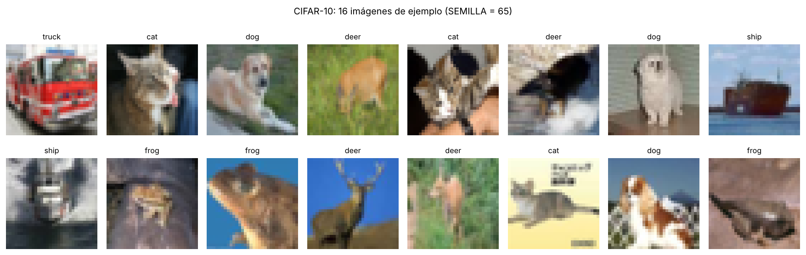
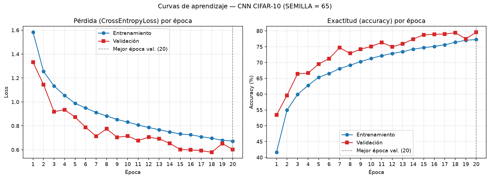
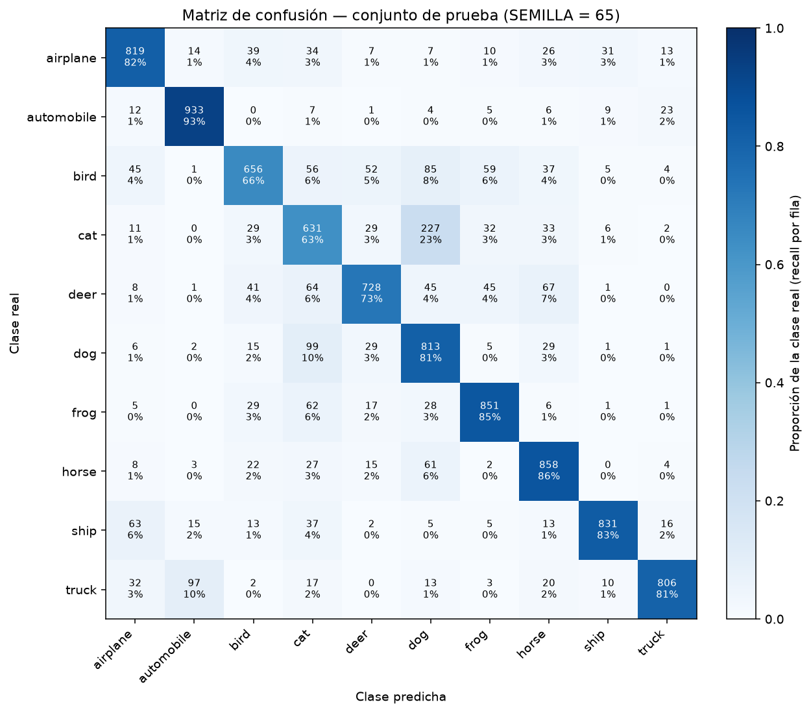

# Clasificación de imágenes CIFAR-10 con una CNN — `SEMILLA = 65`

**Universidad Andina del Cusco**
Departamento Académico / Escuela Profesional de **Ingeniería de Sistemas**
Curso: **Inteligencia Artificial** — Evaluación de la **Segunda Unidad**
Tema: *Clasificación de imágenes mediante CNN, flujo de tensores 4D y análisis de métricas*
Código de matrícula: `021101465` · Semilla individual: **`SEMILLA = 65`**

---

## Índice

1. [Objetivos](#1-objetivos)
2. [Dataset CIFAR-10](#2-dataset-cifar-10)
3. [Pregunta 1 — Carga, visualización, transformaciones y partición](#3-pregunta-1--carga-visualización-transformaciones-y-partición)
4. [Pregunta 2 — Justificación teórica: CNN frente a MLP](#4-pregunta-2--justificación-teórica-cnn-frente-a-mlp)
5. [Pregunta 2 — Arquitectura de la CNN](#5-pregunta-2--arquitectura-de-la-cnn)
6. [Pregunta 3 — Flujo de tensores 4D y validación del forward pass](#6-pregunta-3--flujo-de-tensores-4d-y-validación-del-forward-pass)
7. [Semilla 65 y reproducibilidad](#7-semilla-65-y-reproducibilidad)
8. [Pregunta 4 — Entrenamiento y evaluación](#8-pregunta-4--entrenamiento-y-evaluación)
9. [Resultados obtenidos](#9-resultados-obtenidos)
10. [Análisis crítico: overfitting y underfitting](#10-análisis-crítico-overfitting-y-underfitting)
11. [Estructura del repositorio](#11-estructura-del-repositorio)
12. [Requisitos, instalación y ejecución en Windows](#12-requisitos-instalación-y-ejecución-en-windows)
13. [Limitaciones](#13-limitaciones)
14. [Conclusiones](#14-conclusiones)
15. [Referencias](#15-referencias)

---

## 1. Objetivos

**Objetivo general.** Diseñar, implementar, entrenar y evaluar una red neuronal convolucional (CNN) en PyTorch
que clasifique las imágenes de CIFAR-10 en sus diez clases, garantizando la reproducibilidad del experimento con la
semilla individual 65.

**Objetivos específicos.**

1. Cargar CIFAR-10 con `torchvision`, visualizar muestras etiquetadas y construir un pipeline de transformaciones
   con normalización y aumento de datos.
2. Realizar una partición estratificada entrenamiento/validación con la semilla 65, manteniendo separado el conjunto
   de prueba oficial.
3. Justificar teóricamente el uso de una CNN frente a un perceptrón multicapa (MLP).
4. Implementar la arquitectura y validar el flujo de tensores 4D `(B, C, H, W)` mediante aserciones.
5. Entrenar con `CrossEntropyLoss` y `Adam`, registrar loss y accuracy por época y generar las curvas de aprendizaje
   y la matriz de confusión.
6. Analizar cuantitativamente los resultados y diagnosticar sobreajuste o subajuste.

---

## 2. Dataset CIFAR-10

CIFAR-10 (Krizhevsky, 2009) contiene **60 000 fotografías RGB de 32 × 32 píxeles** en **10 clases** mutuamente
excluyentes: `airplane, automobile, bird, cat, deer, dog, frog, horse, ship, truck`.

| Conjunto oficial | Imágenes | Por clase |
|---|---:|---:|
| Entrenamiento | 50 000 | 5 000 |
| Prueba | 10 000 | 1 000 |

Cada imagen es un tensor de forma `(3, 32, 32)` tras `ToTensor()`: 3 canales (R, G, B) y 32 × 32 = 1 024 píxeles
por canal, es decir, **3 072 valores** por imagen.

**Descarga.** No es necesario descargar nada manualmente. La primera vez que se ejecuta el proyecto,
`torchvision.datasets.CIFAR10(root="data", download=True)` descarga el archivo oficial (~163 MB) desde el sitio de la
Universidad de Toronto, comprueba su integridad (MD5) y lo descomprime en `data/cifar-10-batches-py/`. En las
siguientes ejecuciones detecta que ya existe y no lo vuelve a descargar. Para descargarlo de forma explícita:

```powershell
python -m src.dataset
```

La carpeta `data/` está excluida de Git (`.gitignore`), así que el dataset no se sube al repositorio.

---

## 3. Pregunta 1 — Carga, visualización, transformaciones y partición

Implementado en [`src/dataset.py`](src/dataset.py) y demostrado en
[`notebooks/experiment.ipynb`](notebooks/experiment.ipynb).

### 3.1 Carga y semilla

`load_cifar10()` carga los conjuntos oficiales de entrenamiento y prueba. Antes de cualquier proceso aleatorio se
llama a `config.set_seed(65)` y el barajado del `DataLoader` de entrenamiento usa un `torch.Generator` con semilla 65.

### 3.2 Visualización

`show_samples(dataset, n=16)` dibuja una cuadrícula de 8–16 imágenes con el nombre de su clase real; si recibe
tensores normalizados, aplica `denormalize()` (`x = x_norm · σ + μ`) antes de mostrarlos.



### 3.3 Pipeline de transformaciones

| Subconjunto | Transformaciones |
|---|---|
| Entrenamiento | `RandomCrop(32, padding=4)` → `RandomHorizontalFlip(p=0.5)` → `ToTensor()` → `Normalize(μ, σ)` |
| Validación y prueba | `ToTensor()` → `Normalize(μ, σ)` |

- **`ToTensor()`** convierte la imagen PIL `(H, W, C)` con valores 0–255 en un tensor `float32` `(C, H, W)` con valores en [0, 1].
- **`Normalize(μ, σ)`** estandariza cada canal: `x' = (x − μ_c) / σ_c`. Las estadísticas son la media y la desviación
  estándar por canal de las 50 000 imágenes de entrenamiento, calculadas con `compute_mean_std()`
  (`python -m src.dataset --stats`):
  μ = (0.4914, 0.4822, 0.4465), σ = (0.2470, 0.2435, 0.2616). Centrar y escalar las entradas acelera y estabiliza
  el descenso de gradiente.
- **Aumento de datos (*data augmentation*).** `RandomCrop` con relleno de 4 píxeles desplaza aleatoriamente el
  contenido y `RandomHorizontalFlip` lo refleja. Cada época, la red ve versiones diferentes de las mismas fotos, lo que
  equivale a ampliar el conjunto de entrenamiento con variaciones plausibles (un gato reflejado sigue siendo un gato).
  Esto reduce la memorización de detalles irrelevantes y mejora la generalización.
- **¿Por qué no en validación y prueba?** Estos conjuntos miden el rendimiento sobre imágenes reales y deben dar el
  mismo resultado cada vez. Si se aplicaran transformaciones aleatorias, la métrica variaría entre ejecuciones y no
  representaría el desempeño sobre los datos tal como llegan al modelo.

Para que entrenamiento y validación compartan las mismas imágenes pero con pipelines distintos, se usa la clase
`TransformedSubset`, que aplica su propia transformación a un subconjunto de índices.

### 3.4 Partición estratificada

`stratified_split()` usa `sklearn.model_selection.train_test_split(stratify=etiquetas, random_state=65)` sobre el
conjunto oficial de entrenamiento: **45 000 imágenes de entrenamiento** y **5 000 de validación** (90 % / 10 %). El
conjunto oficial de **prueba (10 000)** se mantiene separado y solo se utiliza una vez, al final. Salida real en consola:

```text
==========================================================================
PARTICIÓN ESTRATIFICADA DE CIFAR-10   (SEMILLA = 65)
==========================================================================
Imágenes de entrenamiento :  45000
Imágenes de validación    :   5000
Imágenes de prueba        :  10000  (conjunto oficial, separado)
Imágenes por lote (batch) :    128
--------------------------------------------------------------------------
Clase          Train       %     Val       %    Test       %
airplane        4500   10.0%     500   10.0%    1000   10.0%
automobile      4500   10.0%     500   10.0%    1000   10.0%
...             (las 10 clases: 4500 / 500 / 1000)
truck           4500   10.0%     500   10.0%    1000   10.0%
--------------------------------------------------------------------------
Tensor de imágenes de un lote : (128, 3, 32, 32)  -> (B, C, H, W)
Tensor de etiquetas           : (128,)  dtype=torch.int64
Tipo de dato de las imágenes  : torch.float32
Lotes por época (train)       : 352
==========================================================================
```

---

## 4. Pregunta 2 — Justificación teórica: CNN frente a MLP

### 4.1 Perceptrón multicapa (MLP)

Un MLP es una red de capas **totalmente conectadas** (`Linear`): cada neurona recibe *todas* las salidas de la capa
anterior, calcula una combinación lineal más un sesgo y aplica una función de activación. Para usar un MLP con una
imagen, primero hay que **aplanarla** en un vector.

### 4.2 Por qué un MLP es ineficiente con CIFAR-10

1. **Explosión de parámetros.** Una imagen de CIFAR-10 aplanada tiene 3 × 32 × 32 = **3 072** entradas. Una sola
   capa oculta de 1 024 neuronas necesita 3 072 × 1 024 + 1 024 = **3 146 752 parámetros**, cinco veces el total de
   la CNN de este proyecto (620 810) y solo en la primera capa. Con imágenes mayores (p. ej. 224 × 224 × 3 = 150 528
   entradas) la cifra crece a cientos de millones. Tantos parámetros exigen mucha memoria y muchos datos, y favorecen
   el sobreajuste.
2. **Pérdida de la estructura espacial.** Al aplanar, dos píxeles vecinos en la imagen quedan como posiciones
   arbitrarias de un vector; el MLP no "sabe" que están juntos y debe aprender esa relación desde cero.
3. **Sin reutilización de lo aprendido.** Si un MLP aprende a detectar una rueda en la esquina superior izquierda, ese
   conocimiento no sirve para una rueda en el centro: son pesos distintos. Debe reaprender el mismo patrón en cada
   posición, lo cual es ineficiente y generaliza mal.

### 4.3 Red neuronal convolucional (CNN)

Una CNN es una red diseñada para datos con estructura de malla (imágenes). Sus capas convolucionales aplican
pequeños **filtros** (núcleos) que se deslizan sobre la imagen y producen **mapas de características**. Las primeras
capas detectan bordes y colores; las siguientes combinan esos patrones en texturas, partes y objetos. Tres
propiedades resuelven las limitaciones del MLP:

- **Conexiones locales.** Cada neurona de un mapa de características solo mira una región pequeña de la entrada (su
  *campo receptivo*, aquí 3 × 3 píxeles) en lugar de toda la imagen. Esto aprovecha que los píxeles cercanos están
  fuertemente correlacionados y reduce drásticamente las conexiones.
- **Compartición de pesos (*weight sharing*).** El mismo filtro (los mismos pesos) se aplica en todas las posiciones
  de la imagen. Un detector de bordes aprendido una vez sirve en cualquier lugar. Por eso la primera capa de este
  modelo tiene solo 3 × 32 × 3 × 3 + 32 = **896 parámetros**, frente a los más de 3 millones del MLP del ejemplo.
- **Equivariancia a traslaciones y robustez espacial.** Gracias al *weight sharing*, si el objeto se desplaza, su
  mapa de características se desplaza igual (equivariancia). Al combinarlo con *pooling*, pequeños desplazamientos
  apenas cambian la salida (invariancia **aproximada** local).

### 4.4 Componentes

- **Convolución (`Conv2d`).** Calcula, en cada posición, el producto punto entre un filtro de pesos aprendibles y el
  parche de entrada, más un sesgo. Con `kernel_size=3` y `padding=1` el alto y ancho se conservan; el número de
  canales de salida es el número de filtros. Su función es **extraer características locales** (bordes, texturas,
  formas) de manera jerárquica.
- **ReLU** (`f(x) = max(0, x)`). Introduce **no linealidad**: sin ella, apilar capas lineales equivaldría a una sola
  transformación lineal. Es barata de calcular y, a diferencia de sigmoide o tanh, no satura para valores positivos,
  lo que reduce el problema del desvanecimiento del gradiente y acelera el entrenamiento.
- **`MaxPool2d(2)`.** Toma el máximo de cada ventana de 2 × 2, **reduciendo a la mitad** el alto y el ancho. Disminuye
  el cómputo y los parámetros de las capas siguientes, amplía el campo receptivo de las capas profundas y aporta
  tolerancia a pequeños desplazamientos (si el máximo se mueve dentro de la ventana, la salida no cambia).
- **`BatchNorm2d`** (adicional). Normaliza las activaciones de cada canal dentro del lote; estabiliza y acelera el
  entrenamiento. No cambia las dimensiones.
- **`Flatten`.** Convierte el tensor 4D `(B, 128, 4, 4)` en una matriz `(B, 2048)` para conectar con las capas densas.
- **Capas `Linear`.** Combinan globalmente las características extraídas por los bloques convolucionales para tomar
  la decisión de clasificación. `fc1` (2048 → 256) aprende combinaciones de alto nivel; `Dropout(0.5)` apaga
  aleatoriamente la mitad de esas neuronas durante el entrenamiento para reducir el sobreajuste.
- **Capa de salida de 10 clases.** `fc2` (256 → 10) produce un **logit** por clase. No se aplica `Softmax` porque
  `CrossEntropyLoss` ya incorpora `LogSoftmax` + `NLLLoss`; la clase predicha es `argmax` de los logits.

### 4.5 Sobre la invariancia: una precisión necesaria

La "invariancia espacial" de una CNN es **parcial y aproximada**, no perfecta:

- La convolución es **equivariante** a traslaciones, no invariante; la invariancia (aproximada y local) proviene del
  *pooling* y de las capas finales.
- El relleno (*padding*), el *stride* y el *pooling* rompen la equivariancia exacta en los bordes y para
  desplazamientos que no son múltiplos del *stride*.
- Una CNN estándar **no** es invariante a rotaciones grandes, cambios de escala, deformaciones, cambios de punto de
  vista o de iluminación. La robustez frente a ellos se obtiene en parte **aprendiéndola** de los datos, por ejemplo
  con *data augmentation* (por eso usamos `RandomCrop` y `RandomHorizontalFlip`).

Por lo tanto, sería incorrecto afirmar que una CNN reconoce un objeto "en cualquier posición, tamaño u orientación";
lo correcto es decir que es **robusta a pequeñas traslaciones y deformaciones**.

---

## 5. Pregunta 2 — Arquitectura de la CNN

La red tiene **tres bloques convolucionales** (el examen exige al menos dos), cada uno con `Conv2d`, `ReLU` y
`MaxPool2d` (más `BatchNorm2d`), seguidos de `Flatten` y dos capas `Linear` hasta las 10 clases.

### 5.1 Diagrama

```text
Entrada (B, 3, 32, 32)
   │
   ├─ Bloque 1 ─ Conv2d(3→32, 3x3, p=1) ─ BatchNorm2d ─ ReLU ─ MaxPool2d(2) ──► (B,  32, 16, 16)
   ├─ Bloque 2 ─ Conv2d(32→64, 3x3, p=1) ─ BatchNorm2d ─ ReLU ─ MaxPool2d(2) ─► (B,  64,  8,  8)
   ├─ Bloque 3 ─ Conv2d(64→128, 3x3, p=1) ─ BatchNorm2d ─ ReLU ─ MaxPool2d(2) ► (B, 128,  4,  4)
   │
   ├─ Flatten ─────────────────────────────────────────────────────────────► (B, 2048)
   ├─ Linear(2048→256) ─ ReLU ─ Dropout(0.5) ───────────────────────────────► (B, 256)
   └─ Linear(256→10)  (logits, sin Softmax) ───────────────────────────────► (B, 10)
```

### 5.2 Especificación de capas

| # | Capa | Configuración | Salida (B = tamaño de lote) | Parámetros | Función |
|---|---|---|---|---:|---|
| 0 | Entrada | imagen RGB normalizada | `(B, 3, 32, 32)` | — | — |
| 1 | `Conv2d` | 3→32, k=3, s=1, p=1 | `(B, 32, 32, 32)` | 896 | extrae bordes/colores |
| 2 | `BatchNorm2d` | 32 canales | `(B, 32, 32, 32)` | 64 | estabiliza activaciones |
| 3 | `ReLU` | — | `(B, 32, 32, 32)` | 0 | no linealidad |
| 4 | `MaxPool2d` | 2×2, s=2 | `(B, 32, 16, 16)` | 0 | reduce H y W a la mitad |
| 5 | `Conv2d` | 32→64, k=3, p=1 | `(B, 64, 16, 16)` | 18 496 | texturas y patrones |
| 6 | `BatchNorm2d` | 64 canales | `(B, 64, 16, 16)` | 128 | |
| 7 | `ReLU` | — | `(B, 64, 16, 16)` | 0 | |
| 8 | `MaxPool2d` | 2×2 | `(B, 64, 8, 8)` | 0 | |
| 9 | `Conv2d` | 64→128, k=3, p=1 | `(B, 128, 8, 8)` | 73 856 | partes de objetos |
| 10 | `BatchNorm2d` | 128 canales | `(B, 128, 8, 8)` | 256 | |
| 11 | `ReLU` | — | `(B, 128, 8, 8)` | 0 | |
| 12 | `MaxPool2d` | 2×2 | `(B, 128, 4, 4)` | 0 | |
| 13 | `Flatten` | 128·4·4 | `(B, 2048)` | 0 | 4D → 2D |
| 14 | `Linear` | 2048→256 | `(B, 256)` | 524 544 | combinación global |
| 15 | `ReLU` + `Dropout(0.5)` | — | `(B, 256)` | 0 | regularización |
| 16 | `Linear` | 256→10 | `(B, 10)` | 2 570 | logits de las 10 clases |
| | **Total** | | | **620 810** | |

Cálculo de parámetros: `Conv2d` = C_in·C_out·k·k + C_out (p. ej. 3·32·9 + 32 = 896); `Linear` = entradas·salidas +
salidas (p. ej. 2048·256 + 256 = 524 544); `BatchNorm2d` = 2·C (escala y desplazamiento).

---

## 6. Pregunta 3 — Flujo de tensores 4D y validación del forward pass

Implementado en [`src/model.py`](src/model.py) (clase `CNNCifar10(nn.Module)` con `forward()`).

PyTorch trabaja con imágenes en formato **(Batch_Size, Channels, Height, Width)**. Para CIFAR-10 la entrada es
`(B, 3, 32, 32)`. Las dimensiones se transforman así:

- **Convolución:** `H_out = ⌊(H + 2p − k) / s⌋ + 1`. Con k = 3, p = 1, s = 1: `H_out = H` (solo cambian los canales).
- **MaxPool2d(2):** `H_out = ⌊(H − 2) / 2⌋ + 1 = H / 2`. Tras tres bloques: 32 → 16 → 8 → 4.
- **Flatten:** `(B, 128, 4, 4)` → `(B, 128·4·4) = (B, 2048)`. Por eso `fc1` tiene `in_features = 2048`; si no coincidiera,
  PyTorch lanzaría un error de *shape mismatch*.

`verify_shapes()` pasa un lote simulado, imprime cada forma intermedia y comprueba con `assert` las dimensiones tras
cada bloque, tras `Flatten` y a la salida. Salida real (`python -m src.model`):

```text
Entrada                      -> (8, 3, 32, 32)
block1.Conv2d                -> (8, 32, 32, 32)
block1.BatchNorm2d           -> (8, 32, 32, 32)
block1.ReLU                  -> (8, 32, 32, 32)
block1.MaxPool2d             -> (8, 32, 16, 16)
block2.Conv2d                -> (8, 64, 16, 16)
block2.BatchNorm2d           -> (8, 64, 16, 16)
block2.ReLU                  -> (8, 64, 16, 16)
block2.MaxPool2d             -> (8, 64, 8, 8)
block3.Conv2d                -> (8, 128, 8, 8)
block3.BatchNorm2d           -> (8, 128, 8, 8)
block3.ReLU                  -> (8, 128, 8, 8)
block3.MaxPool2d             -> (8, 128, 4, 4)
flatten (Flatten)            -> (8, 2048)
fc1 (Linear)                 -> (8, 256)
relu (ReLU)                  -> (8, 256)
dropout (Dropout)            -> (8, 256)
fc2 (Linear)                 -> (8, 10)
------------------------------------------------------------
Parámetros entrenables: 620,810
Aserciones superadas: entrada (8, 3, 32, 32) -> salida (8, 10)
```

La verificación se ejecuta en CPU y, si existe GPU, también en CUDA. `forward()` rechaza entradas que no sean 4D.

---

## 7. Semilla 65 y reproducibilidad

La semilla está **centralizada** en [`src/config.py`](src/config.py) como `SEMILLA = 65` y todos los módulos la
importan desde allí. `config.set_seed(65)` ejecuta:

```python
random.seed(65)
np.random.seed(65)
torch.manual_seed(65)
torch.cuda.manual_seed_all(65)            # si hay GPU
torch.backends.cudnn.deterministic = True
torch.backends.cudnn.benchmark = False
torch.use_deterministic_algorithms(True, warn_only=True)
```

La semilla controla: (1) la partición estratificada (`random_state=65`), (2) el orden de barajado del `DataLoader` de
entrenamiento (`torch.Generator` con semilla 65), (3) la inicialización de los pesos de la red y (4) el aumento de
datos aleatorio y el `Dropout`. Se verificó que dos ejecuciones idénticas producen exactamente los mismos valores de
pérdida y métricas en el mismo equipo. Entre equipos distintos (otra CPU, GPU o versión de PyTorch) pueden aparecer
diferencias numéricas pequeñas por la aritmética de punto flotante.

---

## 8. Pregunta 4 — Entrenamiento y evaluación

Implementado en [`src/train.py`](src/train.py).

| Hiperparámetro | Valor por defecto | Cómo cambiarlo |
|---|---|---|
| Función de pérdida | `nn.CrossEntropyLoss()` | — |
| Optimizador | `torch.optim.Adam` | — |
| Tasa de aprendizaje | 0.001 | `--lr` |
| *Weight decay* (L2) | 0.0005 | `--weight-decay` |
| Épocas | 20 | `--epochs` |
| Tamaño de lote | 128 | `--batch-size` |
| Validación | 10 % | `--val-fraction` |
| Dispositivo | CUDA si existe, si no CPU | automático |

Los valores por defecto están en `src/config.py`.

**Bucle por épocas.** `for epoch in range(EPOCHS):` ejecuta `train_one_epoch()` (con `model.train()`,
`zero_grad → forward → loss → backward → step`) y `evaluate()` sobre validación (con `model.eval()` y
`torch.no_grad()`). En cada época se registran *train loss*, *train accuracy*, *val loss*, *val accuracy* y el tiempo.
Las métricas se acumulan como **suma ponderada por el tamaño de cada lote** y se dividen entre el total de imágenes,
para que el último lote (más pequeño) no distorsione el promedio. Se guarda el modelo con mejor accuracy de
validación.

**Evaluación final.** Se cargan los pesos de la mejor época y se evalúa **una sola vez** sobre las 10 000 imágenes de
prueba. Con `scikit-learn` se calculan accuracy, precision, recall, F1 (macro y ponderados), el reporte por clase y la
matriz de confusión.

**Artefactos generados en `outputs/`:**

| Archivo | Contenido |
|---|---|
| `loss_accuracy.png` | curvas de loss y accuracy (entrenamiento y validación) |
| `confusion_matrix.png` | matriz de confusión del conjunto de prueba |
| `metrics.json` | todas las métricas, hiperparámetros, partición e historial |
| `history.csv` | historial por época |
| `classification_report.txt` | reporte por clase |
| `best_model.pth` | pesos del mejor modelo (≈2.5 MB) |
| `samples_grid.png` | cuadrícula de imágenes de ejemplo |

### Explicación de las métricas

- **Loss (entropía cruzada):** `−log(p_clase_real)` promediado; mide qué tan segura y correcta es la predicción. Menor es mejor.
- **Accuracy:** proporción de imágenes clasificadas correctamente.
- **Precision (clase c):** de las imágenes que el modelo predijo como *c*, cuántas eran realmente *c* (VP / (VP + FP)).
- **Recall (clase c):** de las imágenes que realmente son *c*, cuántas detectó el modelo (VP / (VP + FN)).
- **F1-score:** media armónica de precision y recall: `2·P·R / (P + R)`.
- **Macro:** promedio simple de las 10 clases (todas pesan igual). **Weighted:** ponderado por el número de imágenes
  de cada clase; en CIFAR-10 la prueba está balanceada (1 000 por clase), por lo que ambos coinciden.
- **Matriz de confusión:** filas = clase real, columnas = clase predicha; la diagonal son los aciertos y cada celda
  fuera de ella indica qué clases se confunden entre sí.

---

## 9. Resultados obtenidos

> Todas las cifras de esta sección provienen de la ejecución real de `python run.py` con `SEMILLA = 65`
> en Windows 11, CPU, Python 3.13 y PyTorch 2.14.1, con el dataset CIFAR-10 oficial descargado por torchvision
> (20 épocas, 14.1 minutos; ver `outputs/metrics.json`).

### 9.1 Historial de entrenamiento

| Época | Train loss | Train acc | Val loss | Val acc |
|---:|---:|---:|---:|---:|
| 1 | 1.5833 | 41.59 % | 1.3315 | 53.42 % |
| 2 | 1.2548 | 54.97 % | 1.1451 | 59.62 % |
| 3 | 1.1334 | 59.90 % | 0.9181 | 66.42 % |
| 4 | 1.0542 | 62.75 % | 0.9351 | 66.64 % |
| 5 | 0.9883 | 65.32 % | 0.8735 | 69.50 % |
| 6 | 0.9491 | 66.54 % | 0.7882 | 71.24 % |
| 7 | 0.9123 | 68.06 % | 0.7135 | 74.68 % |
| 8 | 0.8830 | 69.14 % | 0.7752 | 72.88 % |
| 9 | 0.8531 | 70.28 % | 0.7042 | 74.22 % |
| 10 | 0.8315 | 71.29 % | 0.7153 | 75.06 % |
| 11 | 0.8071 | 72.15 % | 0.6771 | 76.36 % |
| 12 | 0.7864 | 72.87 % | 0.7051 | 74.96 % |
| 13 | 0.7676 | 73.41 % | 0.6914 | 75.90 % |
| 14 | 0.7493 | 74.22 % | 0.6542 | 77.40 % |
| 15 | 0.7321 | 74.69 % | 0.6026 | 78.76 % |
| 16 | 0.7253 | 75.10 % | 0.5989 | 78.92 % |
| 17 | 0.7091 | 75.61 % | 0.5926 | 78.98 % |
| 18 | 0.6965 | 76.40 % | 0.5788 | 79.42 % |
| 19 | 0.6799 | 77.02 % | 0.6519 | 77.48 % |
| **20** | **0.6731** | **77.26 %** | **0.6031** | **79.60 %** ← mejor |



### 9.2 Evaluación final sobre el conjunto de prueba (10 000 imágenes)

| Métrica | Valor |
|---|---:|
| **Accuracy** | **79.26 %** |
| Loss | 0.6052 |
| Precision (macro) | 0.8006 |
| Recall (macro) | 0.7926 |
| F1-score (macro) | 0.7937 |

| Clase | Precision | Recall | F1-score |
|---|---:|---:|---:|
| airplane | 0.8117 | 0.8190 | 0.8153 |
| automobile | 0.8752 | 0.9330 | 0.9032 |
| bird | 0.7754 | 0.6560 | 0.7107 |
| cat | 0.6103 | 0.6310 | 0.6205 |
| deer | 0.8273 | 0.7280 | 0.7745 |
| dog | 0.6312 | 0.8130 | 0.7107 |
| frog | 0.8368 | 0.8510 | 0.8438 |
| horse | 0.7836 | 0.8580 | 0.8191 |
| ship | 0.9285 | 0.8310 | 0.8770 |
| truck | 0.9264 | 0.8060 | 0.8620 |



### 9.3 Interpretación de las curvas y de la matriz de confusión

- **Curvas.** La pérdida de entrenamiento desciende de forma continua (1.5833 → 0.6731) y la de validación también
  (1.3315 → 0.6031; mínimo 0.5788 en la época 18), con oscilaciones pequeñas (épocas 8, 12 y 19) propias del ruido
  de un conjunto de 5 000 imágenes. Las curvas de accuracy suben juntas y no se separan.
- **Matriz de confusión.** La clase mejor reconocida es **automobile** (recall 0.933), seguida de horse (0.858) y
  frog (0.851). Las más difíciles son **cat** (recall 0.631), **bird** (0.656) y **deer** (0.728). La confusión
  dominante es **cat → dog: 227 imágenes** (23 % de los gatos), seguida de dog → cat (99), truck → automobile (97),
  bird → dog (85), deer → horse (67) y deer → cat (64). Son pares con forma, textura o contexto parecidos a 32 × 32
  píxeles: animales de cuatro patas, y dos tipos de vehículo con ruedas. La precisión de *dog* (0.631) es baja
  justamente porque muchos gatos se predicen como perros, y la de *automobile* (0.875) baja por los camiones
  clasificados como automóviles.

---

## 10. Análisis crítico: overfitting y underfitting

**¿Hay sobreajuste (overfitting)?** **No.** El sobreajuste se reconoce cuando el error de entrenamiento sigue bajando
mientras el de validación se estanca o sube, abriendo una brecha. Aquí ocurre lo contrario:

| Indicador (época 20) | Entrenamiento | Validación | Diferencia |
|---|---:|---:|---:|
| Loss | 0.6731 | 0.6031 | −0.0700 |
| Accuracy | 77.26 % | 79.60 % | −2.34 pp |

La validación es **mejor** que el entrenamiento. Esto no indica un error: la accuracy de entrenamiento se mide sobre
imágenes **aumentadas** (recortes desplazados y reflejos, más difíciles) y con `Dropout` activo en `model.train()`,
mientras que la validación usa imágenes limpias y la red completa en `model.eval()`. Además, la accuracy de **prueba
(79.26 %)** es prácticamente igual a la de validación (79.60 %, diferencia de 0.34 pp): el modelo generaliza a datos
que nunca vio y la validación fue un buen estimador.

**¿Hay subajuste (underfitting)?** **Ligero.** Una accuracy de entrenamiento de 77.26 % indica que el modelo aún no
ajusta del todo ni siquiera los datos de entrenamiento, y ambas curvas seguían mejorando al final: la mejor época de
validación fue la **última (20)**. Es decir, el entrenamiento se detuvo antes de converger. Las causas probables son
el número limitado de épocas (elegido para que el entrenamiento en CPU dure unos 15 minutos), la regularización
combinada (aumento de datos + Dropout 0.5 + *weight decay*) y la capacidad moderada de la red (620 810 parámetros).

**Qué haría para mejorar.** Entrenar más épocas (30–50) con un *scheduler* de tasa de aprendizaje (p. ej.
`CosineAnnealingLR` o `ReduceLROnPlateau`), usar *early stopping* basado en validación, y aumentar la capacidad con
dos convoluciones por bloque. Si con más épocas la validación empezara a empeorar mientras el entrenamiento mejora,
ese sería el momento de detenerse (inicio del sobreajuste).

---

## 11. Estructura del repositorio

```text
examen-cnn-cifar10-65/
├── src/
│   ├── __init__.py
│   ├── config.py          # SEMILLA = 65, rutas, hiperparámetros, set_seed()
│   ├── dataset.py         # Pregunta 1: carga, transformaciones, partición, visualización
│   ├── model.py           # Pregunta 3: CNN, forward(), validación de shapes
│   └── train.py           # Pregunta 4: entrenamiento, métricas y gráficas
├── notebooks/
│   └── experiment.ipynb   # experimento completo ejecutado (EDA, muestras, pruebas, resultados)
├── outputs/
│   ├── loss_accuracy.png
│   ├── confusion_matrix.png
│   ├── metrics.json
│   ├── history.csv
│   ├── classification_report.txt
│   ├── samples_grid.png
│   └── best_model.pth
├── tests/
│   ├── test_dataset.py
│   └── test_model.py
├── data/
│   └── .gitkeep           # CIFAR-10 se descarga aquí (ignorado por Git)
├── README.md
├── requirements.txt
├── .gitignore
└── run.py                 # punto de entrada
```

---

## 12. Requisitos, instalación y ejecución en Windows

### 12.1 Requisitos de software

- Windows 10/11 (también funciona en Linux y macOS).
- **Python 3.10 – 3.13** ([python.org](https://www.python.org/downloads/); marque *Add Python to PATH* al instalar).
- Visual Studio Code (opcional, recomendado) con las extensiones *Python* y *Jupyter*.
- ~1 GB libre (librerías) + ~350 MB (dataset).
- Dependencias (`requirements.txt`): torch, torchvision, numpy, matplotlib, scikit-learn, pillow, jupyter, ipykernel, pytest.

### 12.2 Instalación paso a paso (PowerShell o terminal de VS Code)

```powershell
# 1. Ir a la carpeta del proyecto
cd ruta\a\examen-cnn-cifar10-65

# 2. Crear el entorno virtual
python -m venv .venv

# 3. Activarlo (PowerShell)
.venv\Scripts\Activate.ps1
#    En CMD:  .venv\Scripts\activate.bat
#    Si PowerShell bloquea el script, ejecute una vez:
#    Set-ExecutionPolicy -Scope CurrentUser RemoteSigned

# 4. Actualizar pip e instalar dependencias
python -m pip install --upgrade pip
pip install -r requirements.txt
```

> **GPU NVIDIA (opcional).** `pip install torch` instala la versión para CPU en Windows. Para usar CUDA, instale antes
> `torch` y `torchvision` con el comando que genera [pytorch.org/get-started/locally](https://pytorch.org/get-started/locally/)
> y luego `pip install -r requirements.txt`.

### 12.3 Comandos para ejecutar cada componente

Todos los comandos se ejecutan **desde la raíz del proyecto** con el entorno activado:

| Objetivo | Comando |
|---|---|
| Verificar entorno y shapes (rápido) | `python run.py --check` |
| Descargar CIFAR-10 + partición + cuadrícula de muestras | `python -m src.dataset` |
| Recalcular media y desviación RGB | `python -m src.dataset --stats` |
| Validar el forward pass (Pregunta 3) | `python -m src.model` |
| Pruebas automatizadas | `python run.py --tests` (o `python -m pytest -v`) |
| Prueba rápida de todo el flujo (1 época, 2 000 imágenes) | `python run.py --quick` → `outputs/quick_test/` |
| **Entrenamiento y evaluación definitivos** | `python run.py` |
| Hiperparámetros personalizados | `python run.py --epochs 30 --batch-size 64 --lr 0.0005` |
| Notebook | `jupyter notebook notebooks/experiment.ipynb` |

`python run.py` comprueba el entorno, valida los shapes y entrena; al terminar sobrescribe los archivos de
`outputs/` con los resultados de su equipo. En una CPU moderna tarda aproximadamente 15–30 minutos; con GPU, pocos
minutos.

---

## 13. Limitaciones

- Se entrenó un único modelo con una sola semilla; no se estimó la variabilidad entre semillas ni se hizo búsqueda
  sistemática de hiperparámetros.
- 20 épocas no bastaron para la convergencia completa (ver análisis de subajuste).
- El entrenamiento se hizo en CPU. Al repetirlo en otra computadora, otra versión de PyTorch o con GPU, los resultados
  pueden variar unas décimas de punto por diferencias en la aritmética de punto flotante, aunque se use la misma semilla.
- Las imágenes de 32 × 32 píxeles limitan el detalle disponible para distinguir clases parecidas (gato/perro).
- La accuracy de validación se mide sobre 5 000 imágenes, por lo que oscila ±1–2 puntos entre épocas.

---

## 14. Conclusiones

1. Se implementó un pipeline completo y reproducible (`SEMILLA = 65`) con CIFAR-10: carga con torchvision,
   normalización por canal, aumento de datos solo en entrenamiento y partición estratificada 45 000 / 5 000 que
   conserva exactamente el 10 % de cada clase, con el conjunto de prueba aislado.
2. La CNN de tres bloques procesa tensores 4D `(B, 3, 32, 32)` hasta `(B, 10)`, validado con aserciones, y usa
   620 810 parámetros: menos que una sola capa oculta de 1 024 neuronas de un MLP (3 146 752), gracias a las
   conexiones locales y la compartición de pesos.
3. Con `CrossEntropyLoss` y `Adam` se alcanzó **79.26 % de accuracy en prueba** (F1 macro 0.7937), casi idéntica a
   la de validación (79.60 %).
4. El modelo **no sobreajusta**; presenta un **ligero subajuste** porque seguía mejorando en la última época.
5. Los errores se concentran en clases visualmente parecidas, sobre todo **gato → perro** (227 de 1 000 gatos).

---

## 15. Referencias

- PyTorch. *torch.nn — Conv2d, MaxPool2d, ReLU, Linear, Flatten, CrossEntropyLoss.* https://pytorch.org/docs/stable/nn.html
- PyTorch. *torch.optim.Adam.* https://pytorch.org/docs/stable/generated/torch.optim.Adam.html
- PyTorch. *Reproducibility.* https://pytorch.org/docs/stable/notes/randomness.html
- PyTorch. *Training a Classifier (CIFAR-10 tutorial).* https://pytorch.org/tutorials/beginner/blitz/cifar10_tutorial.html
- torchvision. *CIFAR10 dataset.* https://pytorch.org/vision/stable/generated/torchvision.datasets.CIFAR10.html
- torchvision. *Transforming and augmenting images.* https://pytorch.org/vision/stable/transforms.html
- Krizhevsky, A. (2009). *Learning Multiple Layers of Features from Tiny Images.* University of Toronto.
  https://www.cs.toronto.edu/~kriz/cifar.html
- scikit-learn. *train_test_split, classification_report, confusion_matrix.* https://scikit-learn.org/stable/
- LeCun, Y., Bengio, Y., & Hinton, G. (2015). Deep learning. *Nature*, 521, 436–444.
- Goodfellow, I., Bengio, Y., & Courville, A. (2016). *Deep Learning*, cap. 9 (Convolutional Networks). MIT Press.
